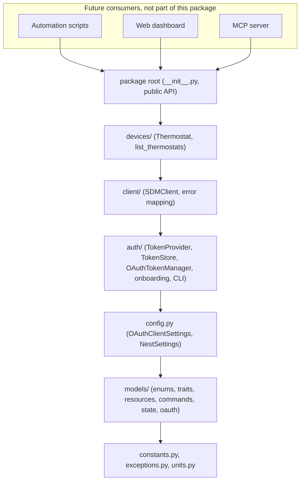

# py-nest-controller architecture

`py-nest-controller` is a typed, async Python SDK for the Google Smart Device
Management (SDM) API, focused on the Nest Thermostat E. It is a library only.
Scripts, a web dashboard, and an MCP server will be built on top of it later,
and the SDK has no knowledge of any of them.

Research date: 2026-10-29. Versions below were read from PyPI on that date.

## 1. Stack

| Job | Chosen tool | Why | Rejected alternatives |
| --- | --- | --- | --- |
| Project and dependency management | uv 0.13.x with the `uv_build` backend | One tool for Python installs, venvs, locking, dependency groups, and building. Very fast, cross platform lockfile, released weekly. `uv_build` understands the src layout with zero config. | Poetry 2: slower resolver, its own config dialect, a second tool still needed for Python installs. Hatch/PDM: fine, but smaller adoption and no advantage here. |
| Async HTTP client | httpx 0.28.1 | Async and sync clients with one API, full type hints, `MockTransport` built in, the de facto client for typed async SDKs (OpenAI, Anthropic, and Google client libraries use it). Lets us add a sync wrapper later without a second library. | aiohttp: async only, weaker typing, heavier API. niquests: interesting HTTP/2 and HTTP/3 support but much smaller ecosystem. Note: httpx has not cut a release since Dec 2024; it is stable and still the most adopted option, so it stays, but watch for the 1.0 line. |
| Data models and validation | Pydantic 2.14 | Field aliases (snake_case in Python, camelCase on the wire), `Literal` and `StrEnum` validation, frozen models, `SecretStr`, mypy plugin. Industry standard. | attrs + cattrs: good, but aliasing and secrets need more glue. msgspec: faster, but a smaller ecosystem and no settings companion. dataclasses: no validation. |
| Settings from env vars | pydantic-settings 2.16 | Same model system as the rest of the SDK, `env_prefix="NEST_"`, `.env` support, `SecretStr`, fails fast with a `ValidationError` listing every missing variable. | python-dotenv alone: no validation. dynaconf / environs: another config model to learn for no gain. |
| Linting and formatting | Ruff 0.17 | One fast tool for lint, import sorting, docstring rules (Google convention), and formatting. Can flag ambiguous unicode, which helps enforce the ASCII rule. | Black + isort + flake8 + pydocstyle: four tools doing what Ruff does alone. |
| Static type checking | mypy 2.4 in `--strict` mode with the Pydantic plugin | The Pydantic plugin understands aliases and model `__init__` signatures; strict mode is the documented bar for this project. | Pyright: excellent and faster, but the Pydantic mypy plugin catches alias mistakes that Pyright does not. ty / pyrefly: promising but still young. |
| Testing | pytest 9.2 + pytest-asyncio 1.4 + respx 0.23 | pytest is the standard. pytest-asyncio in `auto` mode runs `async def` tests with no decorators. respx is purpose built for httpx: route matching by method and URL, typed, works as a pytest fixture. | anyio pytest plugin: fine, but pytest-asyncio is more common for asyncio only code. pytest-httpx: also good, but respx's router reads better when mocking a REST API with many paths. unittest: more boilerplate. |

All seven of your expected defaults are confirmed. The only refinement is the
choice of mocking library: respx over pytest-httpx, for the reason above.

## 2. Layers

Dependency rules in plain words:

1. Imports only point down the diagram. A module may import anything below it
   and nothing above it.
2. `constants`, `exceptions`, and `units` import nothing from the package.
3. `models/` performs no I/O and never imports `config`, `auth`, `client`, or
   `devices`.
4. `client/` depends on the `TokenProvider` Protocol from `auth/`, never on
   `OAuthTokenManager`. Anything with an async `get_access_token()` works.
5. `client/` receives its `httpx.AsyncClient` through the constructor. It never
   creates hidden global clients.
6. `devices/` talks to the API only through `SDMClient`. It never touches httpx.
7. Every public method raises only `NestError` subclasses. httpx and Pydantic
   errors are caught at the layer that sees them and re-raised as a `NestError`
   with the original exception chained (`raise ... from exc`).
8. Nothing in the package names or special cases a specific consumer.

Where each SDM concern lives:

| Concern | Module |
| --- | --- |
| Base URLs, OAuth scope, PCM URL, fan limits | `constants.py` |
| Enums and trait name strings | `models/enums.py` |
| One model per trait | `models/traits.py` |
| Device, Structure, list and error response bodies | `models/resources.py` |
| One request model per command, with its SDM command name | `models/commands.py` |
| Frozen snapshot returned to consumers | `models/state.py` |
| OAuth token response and stored token shape | `models/oauth.py` |
| Env var settings | `config.py` |
| Access token caching and refresh | `auth/manager.py` |
| Token persistence seam | `auth/protocols.py`, `auth/store.py` |
| One time PCM consent and code exchange | `auth/onboarding.py`, `auth/cli.py` (`nest-auth`) |
| URLs, auth headers, parsing, error mapping | `client/sdm.py`, `client/errors.py` |
| Thermostat behavior and SDM rules | `devices/thermostat.py` |
| Finding thermostats on the account | `devices/discovery.py` |

## 3. Extension points

**Sync wrapper.** Add `py_nest_controller/sync.py` with a `SyncThermostat` that
owns a private event loop (or uses `asyncio.run` per call for simple scripts)
and delegates to `Thermostat`. Nothing below `devices/` changes. Do not build a
parallel sync HTTP stack.

**Pub/Sub events (out of scope today).** Events would plug in as a new
`events/` package beside `client/`, at the same layer. It would parse event
messages into the same trait models from `models/traits.py` and could produce
an updated `ThermostatState`. `NestSettings.gcp_project_id` is reserved for the
subscription path. Note from the thermostat docs: Google hosted Pub/Sub topics
are being discontinued and integrations must move to a self hosted topic before
November 30, 2026. See
https://developers.google.com/nest/device-access/api/events.

**Persistent token storage.** Implement the `TokenStore` Protocol (for example
a file, keyring, or database store) and pass it to `OAuthTokenManager`. The
manager does not change. The default is `InMemoryTokenStore`.

**Multiple devices.** `Thermostat` wraps exactly one device ID. Several
thermostats share one `SDMClient` (one HTTP pool, one token manager). Use
`list_thermostats()` to build them. Rate limits are per device for commands
and per project and user for `devices.get` and `devices.list`, so a shared
client is also the right place for any future shared throttling.

**Future consumers.**

- Automation scripts import from the package root and use `Thermostat`.
- A web dashboard would hold one long lived `SDMClient` for the process, use a
  persistent `TokenStore`, and render `ThermostatState`.
- An MCP server would be a separate package that depends on this one and maps
  its tools onto `Thermostat` methods. MCP specific schemas, tool docstrings,
  and agent safety rules belong in that package, not here.

## 4. Suggested implementation order

Each step ends with something you can run against your real thermostat.

1. **Config.** `config.load_settings()` and `OAuthClientSettings`. Fill in
   `.env` with the client ID, client secret, and Device Access project ID.
   Check: `load_settings()` raises `ConfigurationError` naming the missing
   refresh token.
2. **One time OAuth setup.** `auth/onboarding.build_authorization_url()`, then
   `exchange_authorization_code()`, then the `nest-auth` CLI. Run
   `uv run nest-auth url`, approve in the browser, copy the `code`, run
   `uv run nest-auth exchange <code>`, and put the refresh token in `.env`.
   The docs say authorization is not complete until a `devices.list` call is
   made with the new token, so step 4 finishes it.
3. **Token manager.** `InMemoryTokenStore`, then `OAuthTokenManager` (refresh,
   cache, margin, lock). Check: print a fresh access token.
4. **Errors and the low level client.** `client/errors.py`, then
   `SDMClient._request`, `list_devices`, `get_device`. Check: list your
   devices and see the raw traits.
5. **Models.** Fill in anything you want beyond the declarations (the
   `SetRangeCommand` heat < cool validator, the fan duration serializer,
   `Device.device_id`, `ThermostatState.from_device`). Check: parse your real
   device JSON into `Device` and then `ThermostatState`.
6. **Thermostat reads.** `Thermostat.get_state()` and `supports()`, then
   `list_thermostats()`.
7. **Thermostat writes, safest first.** `start_fan` / `stop_fan` (only if your
   system has a fan), `set_mode`, `set_heat` / `set_cool` / `set_range`,
   `set_eco`. Stay under 5 commands per minute while testing.
8. **Tests.** Remove the skip marks one file at a time, starting with
   `tests/client/test_errors.py` and `tests/auth/test_manager.py`.
9. **Units** whenever you want to show Fahrenheit.

## 5. SDM facts checked against the docs

All facts in the brief were confirmed on 2026-10-29. Differences and additions:

- Fan `SetTimer` takes `timerMode` (`ON` or `OFF`) as well as `duration`.
  Duration range is `"1s"` to `"43200s"` (12 hours), default `"900s"`.
- Thermostats also have a device instance limit of 5 commands per minute or
  100 per hour, shared across projects. `devices.get` is 10 per minute and
  `devices.list` is 5 per minute per project and user (Sandbox).
- `SetRange` with heat not below cool returns `INVALID_ARGUMENT` ("Cool value
  must be greater than heat value."), not `FAILED_PRECONDITION`.
  `PERMISSION_DENIED` (403) also exists. Both got their own exceptions.
- The error docs list no dedicated "device offline" code. `DeviceOfflineError`
  is raised from the `Connectivity` trait and for `UNAVAILABLE` (503); this is
  an assumption to confirm against real responses.
- The documented token endpoint is `https://www.googleapis.com/oauth2/v4/token`.
- If the API is rarely called, the refresh token must be used at least once
  every 6 months to keep access.
- `ThermostatTemperatureSetpoint` only returns the value(s) for the current
  mode, and returns nothing in `MANUAL_ECO`.
